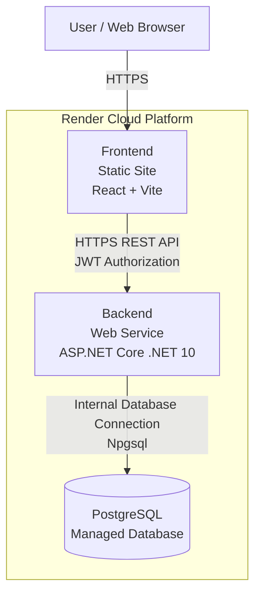

# Cloud Deployment Architecture

## 1. Overview

This document describes the cloud deployment architecture of the Online Banking application. The deployment is based on a modular monolith architecture and uses Render as the hosting platform.

The application consists of three main components:

- **Frontend:** React application built with TypeScript and Vite, deployed as a Render Static Site.
- **Backend:** ASP.NET Core Web API targeting .NET 10, deployed as a Docker-based Render Web Service.
- **Database:** PostgreSQL database hosted by Render and accessed by the backend through an internal connection.

The frontend communicates with the backend through HTTPS REST API requests. The backend handles authentication, business logic, data validation, and database operations.

## 2. Deployment Architecture

The application uses a three-tier deployment structure. Each component is deployed independently, allowing the frontend, backend, and database to be configured and maintained separately.



### 2.1. Frontend

The frontend is deployed as a Render Static Site. It is built from the `frontend/` directory using the Vite production build process.

The generated static files are served directly by Render. The frontend does not connect to the database and does not contain database credentials or backend signing secrets.

The backend API address is provided through the `VITE_API_BASE_URL` environment variable during the build process.

### 2.2. Backend

The backend is deployed as a Docker-based Render Web Service.

The Docker image is built using the repository-level Dockerfile:

`infra/Dockerfile`

The Docker build context is the repository root because the backend project and its dependencies are located inside the `backend/` directory.

The container runs the ASP.NET Core application and listens on the port provided by Render through the `PORT` environment variable.

The backend is responsible for:

- Processing HTTP requests from the frontend.
- Authenticating users and issuing JWT access tokens.
- Enforcing authorization and business rules.
- Coordinating operations across the Clients, Accounts, and Transactions modules.
- Reading and writing application data through Entity Framework Core and Npgsql.
- Returning API responses and handling application errors.

The modular monolith structure remains unchanged after deployment. All business modules execute within a single backend application and share the existing persistence infrastructure.

### 2.3. Database

The application uses a managed PostgreSQL database hosted by Render.

The database stores persistent application data, including client information, accounts, and transaction records. Database access is performed exclusively by the backend through Entity Framework Core and the Npgsql provider.

The database is not exposed directly to the frontend. When the backend and database are deployed in the same Render region, the backend should use the database's internal connection address.

## 3. Component Communication

Communication between the deployed components follows a defined request flow.

1. A user opens the frontend application in a web browser.
2. The frontend sends HTTPS requests to the backend API.
3. For authenticated operations, the frontend includes the JWT access token in the `Authorization` header using the Bearer authentication scheme.
4. The backend validates the token and checks the user's permissions.
5. The appropriate business module processes the request.
6. If persistent data is required, the backend accesses PostgreSQL through Entity Framework Core.
7. The backend returns the result to the frontend as an HTTP response.

The frontend communicates with the backend through its public HTTPS address. Database communication remains internal to the cloud deployment.

## 4. Environment Configuration

Configuration values are supplied through environment variables rather than being stored directly in the source code or Docker image.

The main configuration variables are:

| Component | Variable | Purpose |
|---|---|---|
| Frontend | `VITE_API_BASE_URL` | Public base URL of the backend API |
| Backend | `ASPNETCORE_ENVIRONMENT` | ASP.NET Core environment, set to `Production` |
| Backend | `ConnectionStrings__Default` | PostgreSQL connection string |
| Backend | `Jwt__SecretKey` | Secret key used for JWT signing |
| Backend | `Cors__AllowedOrigins` | Allowed frontend origins for CORS |

The exact CORS environment-variable structure must correspond to the configuration binding implemented in the backend.

Sensitive configuration values, especially database credentials and the JWT signing key, must only be stored in the backend's environment configuration. They must never be included in frontend build variables or committed to the repository.

The frontend's `VITE_API_BASE_URL` is exposed to the browser as part of the built application. Therefore, it must only contain public configuration values.

## 5. Network and Security Considerations

The deployment separates public application access from internal database communication.

The following security measures are applied:

- **HTTPS communication:** Public communication between the browser and application services uses HTTPS.
- **JWT authentication:** Authenticated API requests use Bearer tokens.
- **Authorization:** Access control is enforced by the backend. Frontend role checks are only used for interface behavior and do not replace backend authorization.
- **CORS:** The backend allows requests only from configured frontend origins.
- **Database isolation:** The database is accessed by the backend rather than directly by browser clients.
- **Secret management:** Database credentials and JWT signing keys are stored in backend environment variables.
- **Production configuration:** The deployed backend uses the `Production` environment and must not expose development-only functionality.

## 6. Deployment Configuration

The deployment consists of three Render services.

| Service | Render resource | Configuration |
|---|---|---|
| Frontend | Static Site | Root directory: `frontend/` |
| Backend | Web Service | Dockerfile: `infra/Dockerfile`; build context: repository root |
| Database | PostgreSQL | Managed PostgreSQL instance |

### 6.1. Frontend Deployment

The frontend is built using the following commands:

```bash
npm ci
npm run build
```

The resulting `dist/` directory is used as the static publishing directory.

The `VITE_API_BASE_URL` variable must point to the publicly accessible backend URL.

If the application uses client-side routing, a rewrite rule should direct unmatched frontend routes to `index.html`.

### 6.2. Backend Deployment

The backend is built and published through the Dockerfile.

The Docker image uses the .NET 10 SDK for building and the .NET 10 ASP.NET Core runtime for execution.

The Docker build context must be the repository root so that the Dockerfile can access the complete `backend/` directory and its project configuration files.

The deployed service must listen on the port provided by Render.

### 6.3. Database Deployment

A PostgreSQL instance is created through Render's managed database service.

The backend receives the database connection string through `ConnectionStrings__Default`. The connection string must use the database's internal address when the services are hosted in the same Render region.

Database migrations must be applied before the application depends on the corresponding schema. The migration process must follow the existing database initialization and migration configuration of the backend project.

## 7. Deployment Guide

The deployment process follows the order below:

#### 1. Push the application source code to the configured Git repository.
Production version is in the `main` branch.

#### 2. Create or configure the PostgreSQL database.
For Render: click New -> PostgreSQL.
#### 3. Configure the backend Web Service and its environment variables.
For Render: click New -> Web Service. In settings enter environment variables using the following template:

- AdminBootstrap__Email=admin@example.com 
- AdminBootstrap__Password=admin_password
- ASPNETCORE_ENVIRONMENT=Development
- ConnectionStrings__Default="Host=hostname;
- Port=1234;
- Database=bank_db;
- Username=bank_user;
- Password=password

- Jwt__Audience=OnlineBanking.Web
- Jwt__ExpirationMinutes=60
- Jwt__Issuer=OnlineBanking.Api
- Jwt__SecretKey=secret_key

#### 4. Build and deploy the backend Docker image.
Use the Dockerfile in `infra` folder
#### 5. Apply the required database migrations.
#### 6. Configure the frontend Static Site and its `VITE_API_BASE_URL`.
For Render: click New -> Static Site. Enter one nesessary variable:
VITE_API_BASE_URL=https://cloud-banking-app.onrender.com/
#### 7. Deploy the frontend.
#### 8. Configure the backend CORS policy to allow the deployed frontend origin.
The following variable determines access to the backend:
Cors__AllowedOrigins=https://online-banking-frontend-z7xx.onrender.com
#### 9. Verify communication between the frontend, backend, and database.

When the application is updated, the corresponding service can be redeployed independently. Backend changes may require database migrations, while frontend changes require a new production build.

## 8. Availability and Limitations

The proposed architecture uses managed hosting services to reduce the amount of infrastructure that must be maintained manually.

However, the availability characteristics depend on the selected Render plan:

- Free Web Services may enter a sleep state after a period of inactivity, resulting in increased response time for the first subsequent request.
- Free PostgreSQL instances have storage and lifetime limitations. In particular, Render's free PostgreSQL offering is temporary and should not be treated as permanent production storage.
- The application depends on the availability of the hosting platform and its managed database.
- A single backend Web Service does not provide high availability through multiple application instances.

This deployment is intended primarily for demonstrating cloud deployment, validating application functionality, and supporting the laboratory project. A production deployment would require appropriate database backups, persistent database hosting, monitoring, and a suitable availability configuration.

## 9. Summary

The proposed cloud architecture deploys the Online Banking application as three independent services on Render: a React frontend, an ASP.NET Core backend, and a PostgreSQL database.

The existing modular monolith architecture is preserved. The frontend communicates with the backend through HTTPS REST API requests, while the backend handles authentication, business logic, and database access.

Separating the frontend, backend, and database simplifies deployment and configuration while maintaining the existing internal module boundaries. This approach provides a practical foundation for demonstrating cloud hosting and can be extended in the future with additional monitoring, backup, and availability mechanisms.