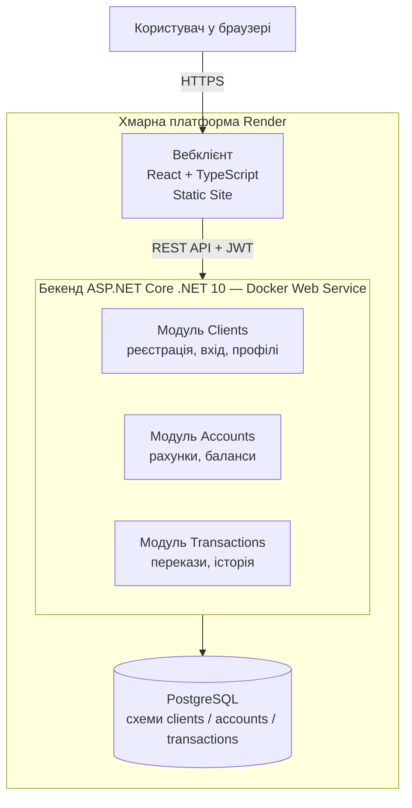
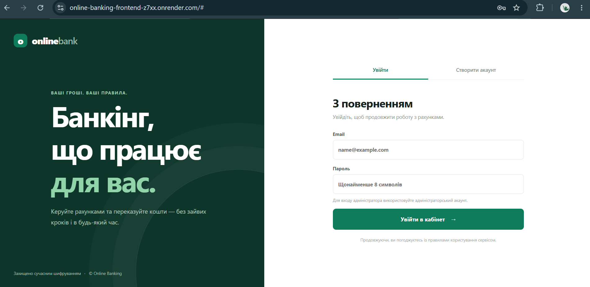
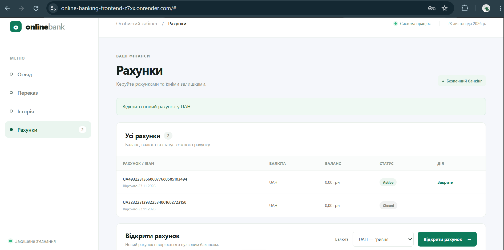
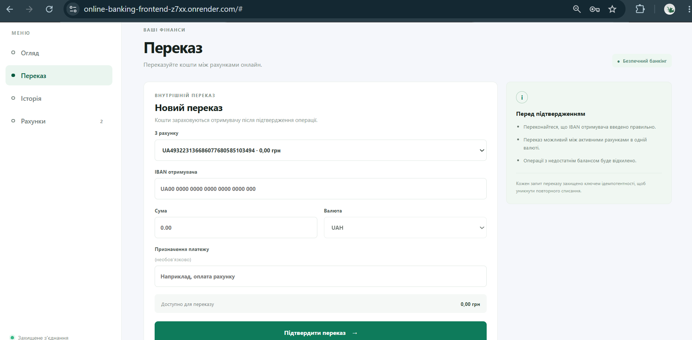
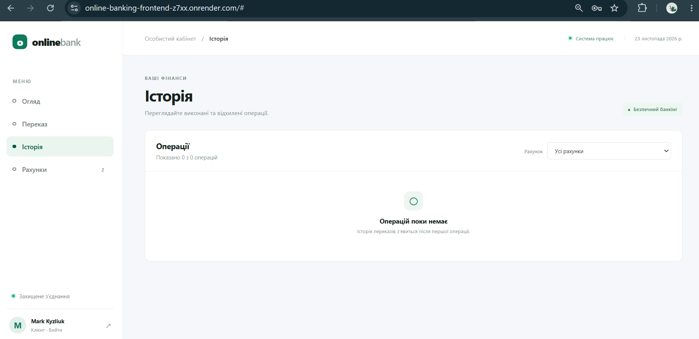
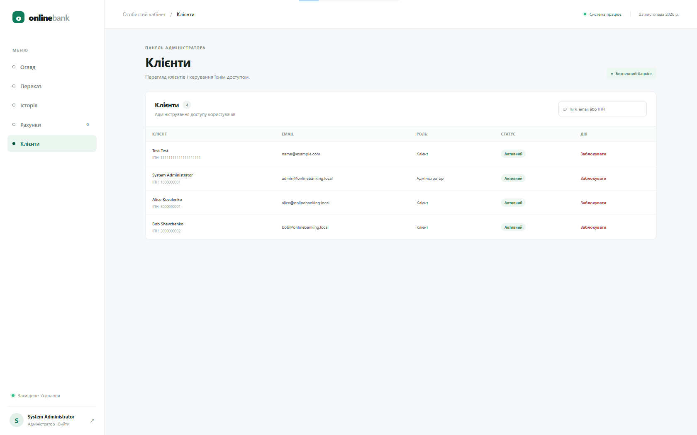

# Звіт до лабораторної роботи 1
## Розробка та розгортання хмарного застосунку

**Дисципліна:** Хмарні та GRID технології
**Група:** ІТ-51мн
**Тема проєкту:** Система онлайн банкінгу

| ПІ | Роль у команді |
|---|---|
| Басюк Валентин | R1 — Backend / Domain |
| Мельник Михайло | R2 — Frontend / QA |
| Ходос Михайло | R3 — DevOps / Cloud |
| Кизлюк Марк | R4 — Integration / Observability / PM |

---

## 1. Що ми зробили

Ми розробили першу версію системи онлайн банкінгу і розгорнули її в хмарі. Клієнт може зареєструватися, увійти, відкрити рахунок у гривні, доларах або євро, переказати гроші іншому клієнту за IBAN і переглянути історію операцій. Адміністратор бачить список клієнтів і може заблокувати або розблокувати клієнта.

Застосунок складається з трьох частин: вебклієнт на React, бекенд на ASP.NET Core (.NET 10) і база даних PostgreSQL. Усі три частини працюють на платформі Render.

Посилання на робочу версію:

| Компонент | Адреса |
|---|---|
| Вебзастосунок | https://online-banking-frontend-z7xx.onrender.com/ |
| API | https://cloud-banking-app.onrender.com/ |
| Інтерактивна документація API | https://cloud-banking-app.onrender.com/scalar/v1 |

> Сервіси працюють на безкоштовному плані Render, тому після простою перший запит може відповідати 30–60 секунд, поки сервер «прокидається».

Ця лабораторна — перший крок наскрізного проєкту. У наступних роботах ми запакуємо цю ж систему в контейнери (ЛР2), розділимо її на мікросервіси і порівняємо з монолітом (ЛР3), а потім додамо моніторинг, автомасштабування і CI/CD (ЛР4). Предметна область і поділ на сервіси взяті з нашої попередньої роботи з архітектури системи онлайн банкінгу.

---

## 2. Як ми розподілили роботу

Команда працює в одному репозиторії. Кожна роль відповідає за свою частину коду і свою папку, тому учасники рідко заважають одне одному.

| Роль | Хто | Плановий обсяг робіт у ЛР1 | Папки |
|---|---|---|---|
| R1 — Backend | Басюк В. | Бізнес-логіка, автентифікація, база даних, тести бекенду | `backend/`, `docs/openapi/`, `docs/database/` |
| R2 — Frontend / QA | Мельник М. | Вебклієнт, тести фронтенду, перевірка сценаріїв безпеки переказів | `frontend/` |
| R3 — DevOps / Cloud | Ходос М. | Docker-образ бекенду, розгортання в хмарі, керована БД, змінні оточення | `infra/` |
| R4 — PM / Integration | Кизлюк М. | План робіт, ролі, правила роботи з репозиторієм, рев'ю PR, звіт | `docs/reports/`, `docs/ai-logs/` |

**Як ми працювали з Git.** Основна гілка `main` містить стабільні версії, гілка `development` — поточну спільну роботу. Кожну задачу робили в окремій гілці і зливали через Pull Request з рев'ю іншого учасника. Зливали без squash, щоб у історії залишились усі проміжні коміти і було видно внесок кожного. Повідомлення комітів писали за стандартом Conventional Commits (`feat:`, `fix:`, `docs:` тощо).

Основні Pull Request ЛР1:

| PR | Автор | Що зроблено |
|---|---|---|
| [#1](https://github.com/Mechano1d/cloud-grid-technologies/pull/1) | R1 | Структура репозиторію, контракт API, каркас бекенду |
| [#3](https://github.com/Mechano1d/cloud-grid-technologies/pull/3) | R1 | Повна реалізація бекенду: модулі, БД, авторизація, тести |
| [#6](https://github.com/Mechano1d/cloud-grid-technologies/pull/6) | R2 | Вебклієнт, його Docker-образ і тести |
| [#7](https://github.com/Mechano1d/cloud-grid-technologies/pull/7) | R3 | Dockerfile бекенду і розгортання на Render |


---

## 3. Архітектура

Для ЛР1 ми обрали **модульний моноліт**. Це один застосунок, але всередині він чітко поділений на три модулі: «Клієнти», «Рахунки» і «Транзакції». Модулі не звертаються одне до одного напряму, а тільки через спільні інтерфейси. Це правило перевіряється автоматичними тестами.




Детальніше: [ADR-001 — архітектура бекенду](../architecture/001-backend-architecture.md), [ADR-003 — архітектура розгортання](../architecture/003-cloud-deployment-architecture.md).

---

## 4. Бекенд 

### Що використано

| Інструмент | Для чого |
|---|---|
| ASP.NET Core Web API (.NET 10) | HTTP API, контролери, маршрутизація |
| Entity Framework Core 10 + Npgsql | Робота з PostgreSQL, міграції схеми |
| JWT Bearer Authentication | Видача та перевірка токенів доступу |
| ASP.NET Core Identity `PasswordHasher` | Безпечне хешування паролів |
| Microsoft.AspNetCore.OpenApi + Scalar | Генерація OpenAPI і інтерактивна документація |
| xUnit, NetArchTest, Testcontainers, Respawn | Модульні, архітектурні та інтеграційні тести |

### Як влаштовано

Бекенд складається з кількох проєктів:
- `OnlineBanking.Api` — точка входу: налаштування, CORS, OpenAPI, health-check;
- три модулі `Module.Clients`, `Module.Accounts`, `Module.Transactions`. Кожен поділений на шари `Api` (контролери), `Application` (сервіси) і `Domain` (сутності та бізнес-правила);
- `Infrastructure` — JWT, хешування паролів, обробка помилок;
- `Persistence` — доступ до БД і міграції;
- `Shared` — спільні контракти і тип `Result` для результатів операцій.

**База даних.** Одна база PostgreSQL, але кожен модуль має свою схему: `clients`, `accounts`, `transactions`. Зовнішніх ключів між схемами навмисно немає, бо в ЛР3 кожна схема переїде в окрему базу свого мікросервісу. Міграції застосовуються автоматично під час запуску (`Database.MigrateAsync()`). Окремо є SQL-скрипт [`initial-migrations.sql`](../database/initial-migrations.sql).

**Авторизація.** Після входу користувач отримує JWT-токен, який фронтенд передає в заголовку `Authorization: Bearer ...`. Є дві ролі: `Client` і `Admin`. Адмінські операції захищені атрибутом `[Authorize(Roles = "Admin")]`. Клієнт бачить і використовує тільки свої рахунки.

**Переказ коштів** — найважливіша операція. Щоб гроші не «зникли» і не «подвоїлись»:
1. Клієнт може передати заголовок `Idempotency-Key`. Якщо такий переказ уже був, повертається попередній результат, і гроші не списуються вдруге.
2. Обидва рахунки блокуються в базі (`SELECT ... FOR UPDATE`) завжди в однаковому порядку. Так одночасні зустрічні перекази не створюють взаємного блокування (deadlock).
3. Списання і зарахування виконуються в одній транзакції БД: або проходять обидва, або жодне.
4. Якщо коштів не вистачає, API повертає `409 Conflict` зі зрозумілим описом помилки у форматі ProblemDetails (RFC 7807).

### Тестування

- **Модульні тести** перевіряють бізнес-правила: рахунок, клієнта, транзакцію, генерацію IBAN, тип `Result`.
- **Архітектурні тести** (NetArchTest) гарантують, що модулі не посилаються один на одного.
- **Інтеграційні тести** запускають справжній PostgreSQL у Docker через Testcontainers. Вони перевіряють реєстрацію, вхід, рахунки, перекази, одночасні перекази і спробу переказу з чужого рахунку.

Запуск усіх тестів: `dotnet test backend/OnlineBanking.slnx -c Release`. Для інтеграційних тестів потрібен запущений Docker.

### Альтернативи

- **Мікросервіси одразу** — відкинули: занадто складно для ЛР1, а порівняння архітектур однаково буде в ЛР3.
- **Звичайний моноліт без меж між модулями** — відкинули: пізніше його важко розділити.
- **MediatR і AutoMapper** — не використали: вони додають зайвий рівень абстракції, а прямі виклики сервісів простіше читати й налагоджувати.
- **Python / FastAPI** — ми розглядали цей варіант на старті, але обрали .NET через сувору типізацію і зручні інструменти для модульної архітектури та тестування.

### Документація
- JWT у ASP.NET Core: https://learn.microsoft.com/en-us/aspnet/core/security/authentication/configure-jwt-bearer-authentication
- Міграції EF Core: https://learn.microsoft.com/en-us/ef/core/managing-schemas/migrations/
- Npgsql для EF Core: https://www.npgsql.org/efcore/
- Обробка помилок і ProblemDetails: https://learn.microsoft.com/en-us/aspnet/core/web-api/handle-errors
- OpenAPI в ASP.NET Core: https://learn.microsoft.com/en-us/aspnet/core/fundamentals/openapi/overview
- Блокування рядків у PostgreSQL: https://www.postgresql.org/docs/current/explicit-locking.html#LOCKING-ROWS
- Testcontainers для .NET: https://dotnet.testcontainers.org/

---

## 5. Фронтенд і тестування

### Що використано

| Інструмент | Для чого |
|---|---|
| React 19 + TypeScript | Інтерфейс користувача |
| Vite | Локальний сервер розробки і збирання |
| Vitest + Testing Library | Тести фронтенду |
| Nginx (у Docker) | Роздача зібраного застосунку в контейнері |

### Що вміє вебклієнт

- реєстрація і вхід;
- перегляд рахунків і балансу, відкриття і закриття рахунку;
- переказ за IBAN;
- історія операцій з пагінацією і фільтрами;
- для адміністратора — список клієнтів і зміна їхнього статусу.

Інтерфейс показує стан завантаження, успіх і помилки. Помилки від API перетворюються на зрозумілі українські повідомлення.

### Як фронтенд працює з API

Усі запити до сервера зібрані в одному файлі [`api.ts`](../../frontend/src/api.ts), а типи даних у [`types.ts`](../../frontend/src/types.ts) відповідають контракту OpenAPI. Для кожного переказу фронтенд генерує свій `Idempotency-Key`, тому повторне натискання кнопки не спише гроші двічі. Адреса API задається змінною `VITE_API_BASE_URL` під час збирання.

Перевірки ролей в інтерфейсі лише ховають зайві кнопки. Справжній захист робить сервер: навіть якщо хтось обійде інтерфейс, API не дозволить звичайному клієнту виконати адмінську дію.

### Тестування

- **Тести фронтенду** перевіряють, що токен додається до запитів, помилки сервера показуються користувачу, переказ має ключ ідемпотентності, а невдалий вхід відображається коректно.
- **Тест безпеки.** додано інтеграційний тест, який перевіряє, що зловмисник не може переказати гроші з чужого рахунку, і що після такої спроби не змінюються ні баланси, ні історія.

### Скріншоти







### Альтернативи

- **Серверний рендеринг (Next.js) або окремий BFF** — відкинули: API вже має все потрібне, а простий SPA легше розгортати окремо.
- **Автоматична генерація клієнта з OpenAPI** — відклали: контракт поки невеликий, і ручні типи простіші.
- **Зберігати токен тільки в пам'яті** — відкинули, бо після оновлення сторінки користувача викидало б із системи. Зараз токен лежить у `localStorage`. Це компроміс для лабораторної: у реальному банку краще використовувати HttpOnly-cookie.

### Документація
- Змінні оточення у Vite: https://vite.dev/guide/env-and-mode
- React: https://react.dev/learn
- Vitest: https://vitest.dev/guide/

Детальніше: [ADR-002 — архітектура фронтенду](../architecture/002-frontend-architecture.md), [інструкція користувача](../../frontend/README.md).

---

## 6. Розгортання в хмарі 

### Обрана платформа

Усе розгорнуто на **Render** у вигляді трьох окремих сервісів:

| Компонент | Тип ресурсу Render | Як збирається |
|---|---|---|
| Фронтенд | Static Site | `npm ci` → `npm run build`, публікується папка `dist/` |
| Бекенд | Web Service (Docker) | За [`infra/Dockerfile`](../../infra/Dockerfile), контекст — корінь репозиторію |
| База даних | Managed PostgreSQL | Створюється через панель Render |

### Docker-образ бекенду

Dockerfile має два етапи (multi-stage):
1. **Збирання** на образі `dotnet/sdk:10.0`: відновлення залежностей і `dotnet publish`.
2. **Запуск** на легшому образі `dotnet/aspnet:10.0`: тільки готові файли застосунку, без SDK.

Завдяки цьому фінальний образ менший і не містить інструментів розробки.

### Налаштування і секрети

Паролі та ключі не зберігаються ні в коді, ні в образі. Вони задаються як змінні оточення в панелі Render:
- `ConnectionStrings__Default` — підключення до PostgreSQL;
- `Jwt__SecretKey`, `Jwt__Issuer`, `Jwt__Audience` — параметри токенів;
- `Cors__AllowedOrigins` — адреса фронтенду, з якої бекенд приймає запити;
- `AdminBootstrap__Email` / `AdminBootstrap__Password` — перший адміністратор.

Фронтенд отримує тільки публічну адресу API (`VITE_API_BASE_URL`), бо все, що потрапляє у фронтенд, видно в браузері. Бекенд підключається до бази за внутрішньою адресою Render, тому база не відкрита в інтернет.

### Чому Render

| Варіант | Плюси | Мінуси |
|---|---|---|
| **Render** (обрали) | Безкоштовний план, деплой прямо з GitHub, підтримка Docker і керованого PostgreSQL | Сервіс «засинає» після простою, безкоштовна БД тимчасова |
| Azure App Service | Глибока інтеграція з .NET, студентські кредити | Складніше налаштування, ризик витратити кредити |
| Google Cloud Run | Гнучкий, оплата за запити | Потрібна окрема керована БД (Cloud SQL) і більше налаштувань |
| Heroku | Простий | Немає безкоштовного плану |

Для лабораторної нам важливо швидко і безкоштовно показати робочий застосунок у хмарі, тому Render — оптимальний вибір. Перенесення в Kubernetes заплановане на ЛР4.

### Документація
- Docker на Render: https://render.com/docs/docker
- Static Sites на Render: https://render.com/docs/static-sites
- PostgreSQL на Render: https://render.com/docs/postgresql-creating-connecting
- Змінні оточення на Render: https://render.com/docs/environment-variables
- Обмеження безкоштовного плану: https://render.com/docs/free
- Multi-stage збирання Docker: https://docs.docker.com/build/building/multi-stage/

Детальніше: [ADR-003 — архітектура розгортання](../architecture/003-cloud-deployment-architecture.md).

---

## 7. Контракт API

| Група | Ендпоінти | Доступ |
|---|---|---|
| System | `GET /health` | усі |
| Auth | `POST /api/v1/auth/register`, `POST /api/v1/auth/login` | усі |
| Clients | `GET /api/v1/clients/me` | клієнт |
| | `GET /api/v1/clients`, `PATCH /api/v1/clients/{id}/status` | адмін |
| Accounts | `GET`/`POST /api/v1/accounts`, `GET /api/v1/accounts/{id}`, `POST /api/v1/accounts/{id}/close` | клієнт |
| Transactions | `POST /api/v1/transactions/transfers`, `GET /api/v1/transactions`, `GET /api/v1/transactions/{id}` | клієнт |

Помилки повертаються в єдиному форматі ProblemDetails:

| Код | Коли |
|---|---|
| 400 | Невалідні дані (наприклад, від'ємна сума) |
| 401 | Немає токена або він недійсний |
| 403 | Немає прав (клієнт викликає адмінську операцію) |
| 404 | Рахунок або транзакцію не знайдено |
| 409 | Конфлікт: email уже зайнятий, недостатньо коштів, рахунок закрито |

Переглянути і випробувати API можна в інтерактивній документації: https://cloud-banking-app.onrender.com/scalar/v1

Специфікація OpenAPI: https://spec.openapis.org/oas/v3.1.0

---

## 8. Код у репозиторії

- **Репозиторій:** https://github.com/Mechano1d/cloud-grid-technologies
- **Версія ЛР1:** тег [`lab1`](https://github.com/Mechano1d/cloud-grid-technologies/tree/lab1)

| Каталог | Вміст |
|---|---|
| [`backend/`](https://github.com/Mechano1d/cloud-grid-technologies/tree/lab1/backend) | Бекенд .NET 10 і тести |
| [`frontend/`](https://github.com/Mechano1d/cloud-grid-technologies/tree/lab1/frontend) | Вебклієнт React |
| [`infra/`](https://github.com/Mechano1d/cloud-grid-technologies/tree/lab1/infra) | Dockerfile для хмари |
| [`docs/`](https://github.com/Mechano1d/cloud-grid-technologies/tree/lab1/docs) | Контракт API, архітектурні рішення, звіти, логи ШІ |

---

## 9. Як запустити локально

Потрібні: .NET 10 SDK, Node.js 22+, Docker.

**1. База даних:**
```powershell
docker run -d --name banking-postgres `
  -e POSTGRES_DB=online_banking `
  -e POSTGRES_USER=banking_user `
  -e POSTGRES_PASSWORD=change_me_local_password `
  -p 5432:5432 postgres:17-alpine
```

**2. Бекенд** (у першому терміналі, з кореня репозиторію):
```powershell
$env:ConnectionStrings__Default = "Host=localhost;Port=5432;Database=online_banking;Username=banking_user;Password=change_me_local_password"
$env:Jwt__SecretKey = "replace_with_at_least_32_char_secret_key_for_local_dev"
dotnet run --project backend/src/Monolith/OnlineBanking.Api --environment Development --urls http://localhost:8080
```
Документація API відкриється на http://localhost:8080/scalar/v1

**3. Фронтенд** (у другому терміналі):
```powershell
cd frontend
npm ci
npm run dev
```
Застосунок відкриється на http://localhost:5173

Детальніше: [README](../../README.md) і [frontend/README.md](../../frontend/README.md).

---

## 10. Використання засобів ШІ

Логи використання ШІ лежать у папці [`docs/ai-logs/`](../ai-logs/).

| Роль | Інструмент | Для чого використовували | Як перевіряли | Лог |
|---|---|---|---|---|
| R1 | <заповнює R1> | | | [`r1-backend/`](../ai-logs/r1-backend/) |
| R2 | Github Copilot | Інтерфейс клієнта, архітектура застосунку, тести API, розгортання на Docker. | | [`r2-frontend/`](../ai-logs/r2-frontend/) |
| R3 | ChatGPT | Драфт документації, огляд cloud-архітектур, документація Render. | | [`r3-devops/`](../ai-logs/r3-devops/) |
| R4 | Claude (Anthropic) | Розбір завдань курсу, план робіт і розподіл ролей, робота з Git , рев'ю PR, чернетка цього звіту | Порівнював план із вимогами викладача, факти у звіті звіряв з кодом і документацією в репозиторії | [`r4-obs-pm/`](../ai-logs/r4-obs-pm/) |

---

## 11. Висновки

1. Ми створили робочий хмарний застосунок онлайн банкінгу з усіма основними можливостями, які вимагає завдання: обмін даними з сервером, збереження в базі даних, автентифікація та розмежування прав.
2. Модульний моноліт виявився вдалим вибором для старту: його просто розгорнути, а межі між модулями вже підготовлені до розбиття на мікросервіси в ЛР3.
3. Найскладніше було коректно реалізувати переказ коштів. Блокування рахунків у фіксованому порядку, одна транзакція БД і ключ ідемпотентності гарантують, що гроші не зникнуть і не спишуться двічі, навіть при одночасних запитах. Це підтверджено інтеграційними тестами.
4. Контракт API, складений до початку розробки, дозволив бекенду і фронтенду працювати паралельно. Тому базову версію ми зробили за кілька днів.
5. Render дозволив безкоштовно розгорнути застосунок разом із керованою базою даних. Його обмеження (засинання сервісу, тимчасова безкоштовна БД) прийнятні для навчального проєкту, але не для реальної системи.
6. Робота через гілки, Pull Request і рев'ю зробила внесок кожного учасника видимим, а рев'ю допомогло знайти недоліки, які ми виправимо в наступних роботах.
